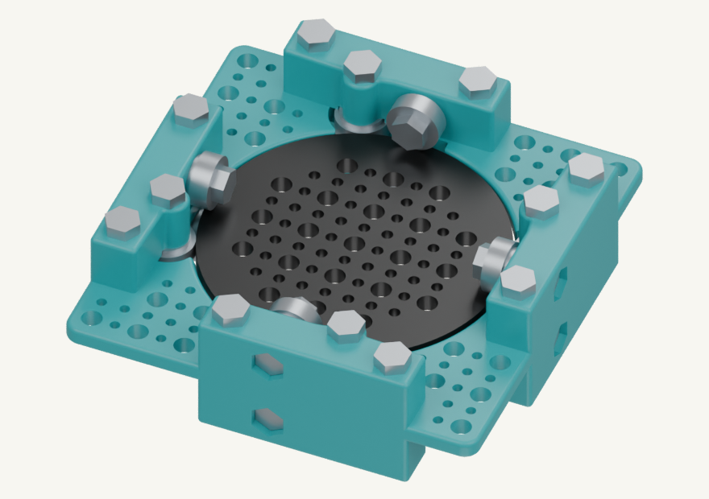

<!-- oobb-presentation:start -->
# OOBB turrets

AI-generated CAD illustrations and instructions. Errors possible.

## Summary

Three square frames on the 15 mm OOBB grid carry a rotating 6 mm disc with M6 mounting holes and an M3 half-grid. Four pairs of housings guide the disc on 606 bearings. The editable CAD and generated files are included for printing and modification.

## Details

The exposed plate and housing edges have a 1.5 mm radius. Flat housing lands carry the clamping load. Each face roller runs on an M6 × 20 external-hex bolt. Three M6 × 40 bolts per station engage nuts recessed into the lower housing. Washers are M6 × Ø14 × 1.5 mm at the bearing-to-print interfaces.

## Parts

[Browse by plate size](navigation_oobb/) · [Build and publishing instructions](presentation/README.md)

| Frame | Usable centre | Full print | Assembly |
|---|---|---|---|
| [7 × 7](parts/oobb_part_turret_7_width_7_height_6_depth_3_turret_diameter_606_bearing_4_number_of_guides/) | Ø45 mm | [STL](parts/oobb_part_turret_7_width_7_height_6_depth_3_turret_diameter_606_bearing_4_number_of_guides/3dpr.stl) | [Viewer](parts/oobb_part_turret_7_width_7_height_6_depth_3_turret_diameter_606_bearing_4_number_of_guides/assembly/assembly_instructions.html) · [PDF](parts/oobb_part_turret_7_width_7_height_6_depth_3_turret_diameter_606_bearing_4_number_of_guides/assembly/assembly_instructions.pdf) |
| [9 × 9](parts/oobb_part_turret_9_width_9_height_6_depth_5_turret_diameter_606_bearing_4_number_of_guides/) | Ø75 mm | [STL](parts/oobb_part_turret_9_width_9_height_6_depth_5_turret_diameter_606_bearing_4_number_of_guides/3dpr.stl) | [Viewer](parts/oobb_part_turret_9_width_9_height_6_depth_5_turret_diameter_606_bearing_4_number_of_guides/assembly/assembly_instructions.html) · [PDF](parts/oobb_part_turret_9_width_9_height_6_depth_5_turret_diameter_606_bearing_4_number_of_guides/assembly/assembly_instructions.pdf) |
| [11 × 11](parts/oobb_part_turret_11_width_11_height_6_depth_7_turret_diameter_606_bearing_4_number_of_guides/) | Ø105 mm | [STL](parts/oobb_part_turret_11_width_11_height_6_depth_7_turret_diameter_606_bearing_4_number_of_guides/3dpr.stl) | [Viewer](parts/oobb_part_turret_11_width_11_height_6_depth_7_turret_diameter_606_bearing_4_number_of_guides/assembly/assembly_instructions.html) · [PDF](parts/oobb_part_turret_11_width_11_height_6_depth_7_turret_diameter_606_bearing_4_number_of_guides/assembly/assembly_instructions.pdf) |

## Assembly

Start with the [one-guide fit sample](parts/oobb_part_turret_9_width_9_height_6_depth_5_turret_diameter_606_bearing_4_number_of_guides/guide_fit_sample.stl) to check nut capture, washer seats and roller adjustment. The illustrated books show the full hardware inventory and sequence. Physical fit has yet to be tested.

Run `python working.py` to populate the records and rebuild the drawings, print models, renders and assembly books. Run `python working.py --assembly-only` to republish from the current CAD. Run `python -m unittest discover -s tests` for the fit and mesh checks.
<!-- oobb-presentation:end -->
