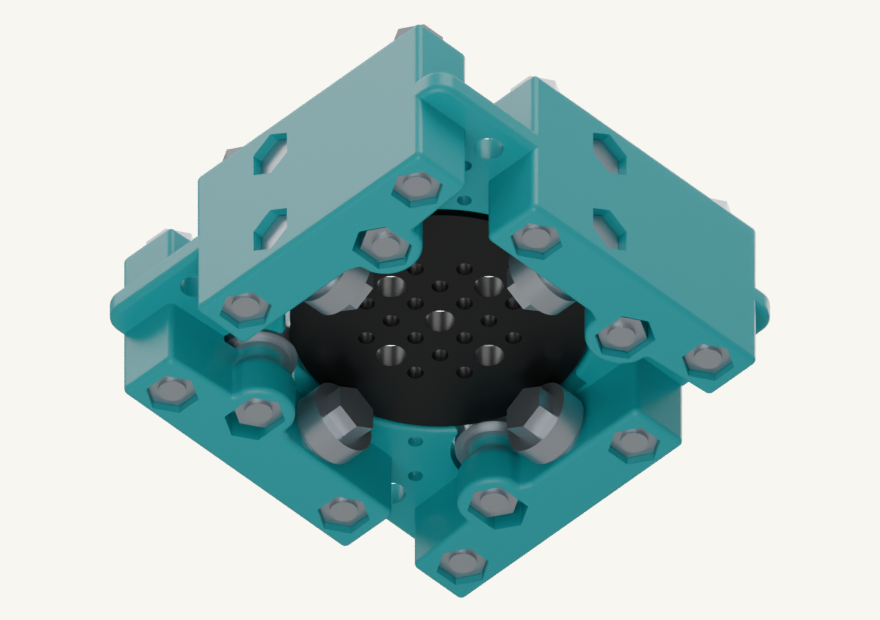
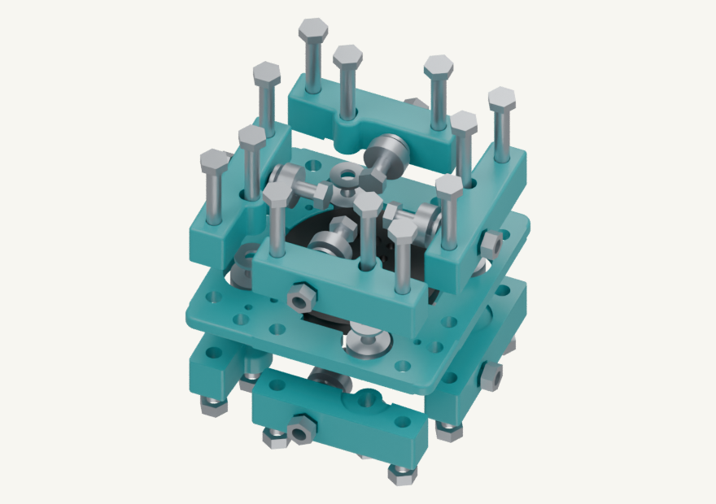
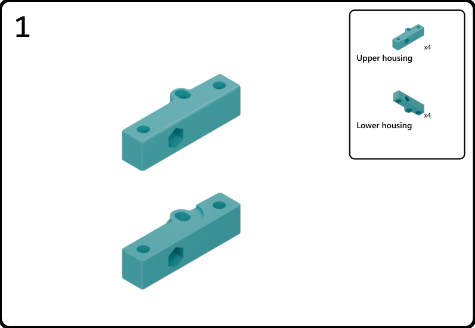
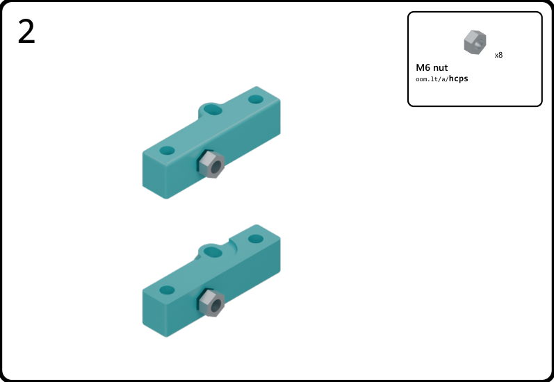
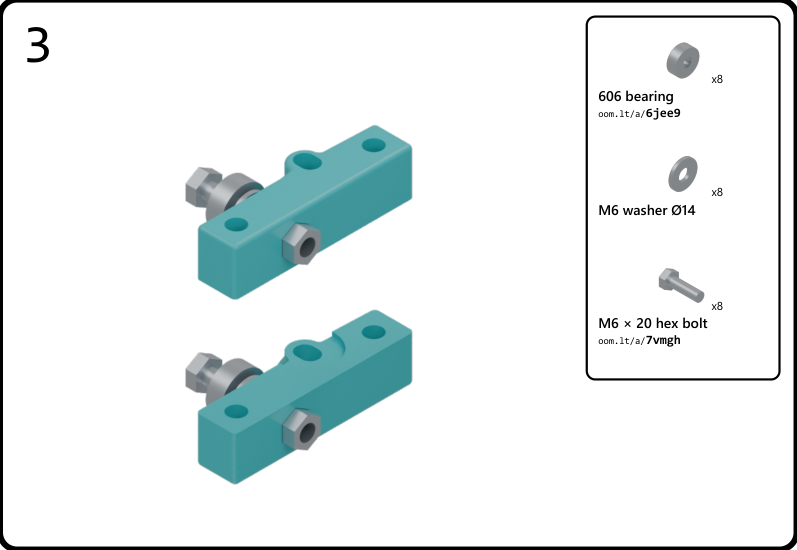
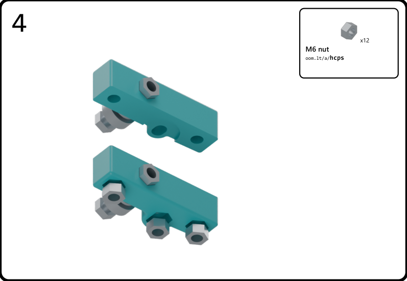
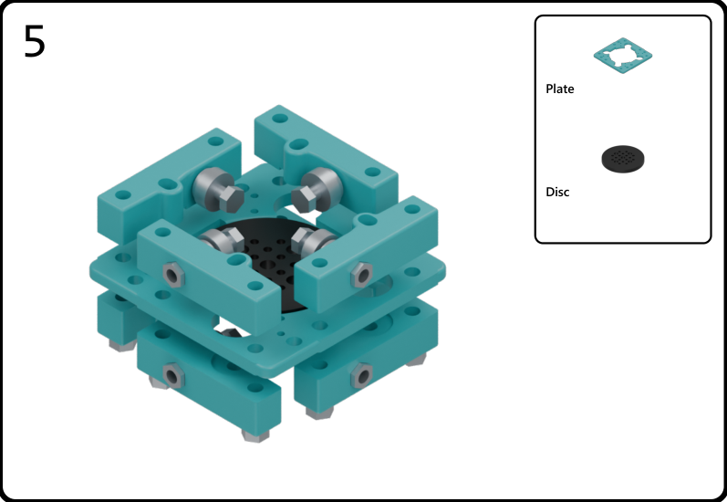
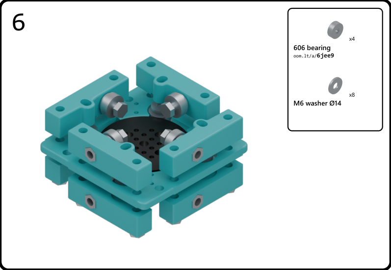
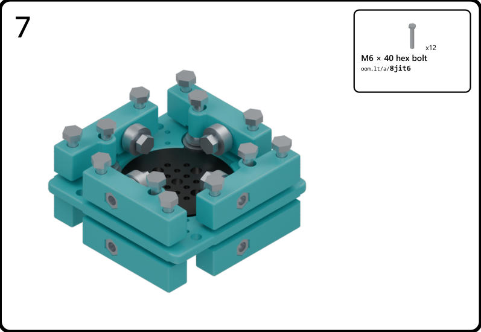
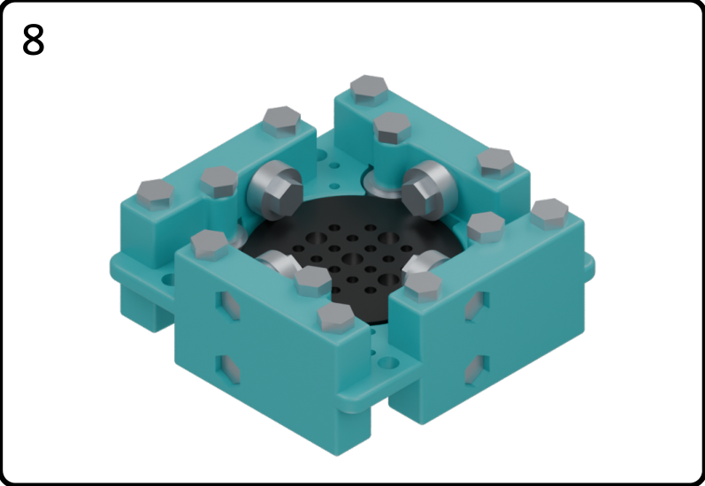

<!-- oobb-presentation:start -->
# 7 × 7 OOBB turret

AI-generated CAD illustrations and instructions. Physical fit is unverified.

## Summary

## Details

The 6 mm frame and disc have a 45 mm usable centre. The disc carries M6 holes on the 15 mm grid and M3 holes on the 7.5 mm half-grid. The outer bearing track stays solid. Exposed frame edges and housing edges have a 1.5 mm radius. Flat lands support the housings. The lower housing captures all three vertical nuts.

## Parts

[Complete print layout](3dpr.stl) · [Replacement upper and lower housing pair](guide_pair.stl) · [One-guide fit sample](guide_fit_sample.stl) · [Hardware and quantities](assembly/parts.csv) · [OOMP record](working.yaml)

The circular frame pocket continues into both housings up to the washer seats. It clears the full edge bearing at every axle setting. Print one replacement housing pair per guide.

| Item | Quantity |
|---|---:|
| Plate | 1 |
| Disc | 1 |
| Upper housing | 4 |
| Lower housing | 4 |
| [606 bearing](https://github.com/oomlout/oomp_bearing_version_5/tree/main/parts/hardware_bearing_600_series_606_size_6_mm_id_17_mm_od_6_mm_depth) | 12 |
| M6 washer Ø14 × 1.5 mm, 6 mm bore | 16 |
| [M6 × 20 hex bolt](https://github.com/oomlout/oomp_hardware_bolt_version_5/tree/main/parts/hardware_set_screw_m6_20_mm_length) | 8 |
| [M6 × 40 hex bolt](https://github.com/oomlout/oomp_hardware_bolt_version_5/tree/main/parts/hardware_set_screw_m6_40_mm_length) | 12 |
| [M6 nut](https://github.com/oomlout/oomp_hardware_bolt_version_5/tree/main/parts/hardware_nut_m6) | 20 |

## Assembly

[Offline illustrated viewer](assembly/assembly_instructions.html) · [Printable booklet](assembly/assembly_instructions.pdf) · [Clearance model](guide_clearance.scad)

The first four illustrations show one guide. Repeat for all four stations. The printed stack is 41 mm from face to face. Each vertical nut seats 7 mm inside the underside. A 40 mm bolt passes fully through the nut and ends 1 mm inside the surface.

**1. Identify the housings**

Set out the four guide pairs. Each lower housing has three hex recesses on its outside face.

**2. Load the face-axle nuts**

Press one M6 nut into the side opening of every upper and lower housing.

**3. Fit the face rollers**

Pass an M6 × 20 hex bolt through each 606 bearing and one washer. Screw it into the side nut. Keep the washer against the printed housing.

**4. Load the lower housings**

Press three M6 nuts into the underside of each lower housing. The centre nut can slide along its pocket for edge adjustment.

**5. Seat the frame and disc**

Set the frame on the four lower housings with their mounting holes aligned. Centre the disc in the opening with its underside on the face rollers.

**6. Stack the edge rollers**

At each station, sandwich the 606 edge bearing between two washers. Seat the washers in the circular housing recesses, align the axle slot and close the upper housing onto the frame.

**7. Join the guides**

Install three M6 × 40 hex bolts from above at each station. The two outer bolts join the housings to the frame. Leave the edge-axle bolt loose for adjustment.

**8. Set the running fit**

Bring each edge roller into light contact. Tighten the edge axles and turn the disc through a full revolution. Check that the rollers turn freely and the housings sit flat.

<!-- oobb-presentation:end -->
