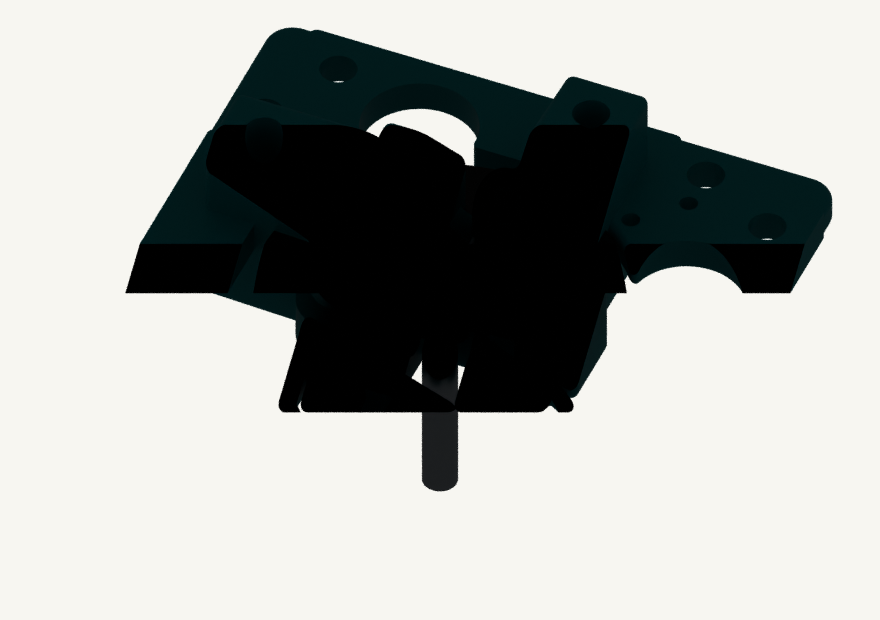

# 7 × 7 OOBB turret

AI-generated CAD illustrations and instructions. Physical fit is unverified.

## Summary

## Details

The 6 mm frame and disc have a 45 mm usable centre. Exposed frame edges and housing edges have a 1.5 mm radius. Flat lands support the housings. The lower housing captures all three vertical nuts.

## Parts

[Complete print layout](3dpr.stl) · [One-guide fit sample](guide_fit_sample.stl) · [Hardware and quantities](assembly/parts.csv) · [OOMP record](working.yaml)

## Assembly

[Offline illustrated viewer](assembly/assembly_instructions.html) · [Printable booklet](assembly/assembly_instructions.pdf) · [Clearance model](guide_clearance.scad)

1. Set out the four guide pairs. Each lower housing has three hex recesses on its outside face.
2. Press one M6 nut into the side opening of every upper and lower housing.
3. Pass an M6 × 20 hex bolt through each 606 bearing and one washer. Screw it into the side nut. Keep the washer against the printed housing.
4. Press three M6 nuts into the underside of each lower housing. The centre nut can slide along its pocket for edge adjustment.
5. Set the frame on the four lower housings with their mounting holes aligned. Centre the disc in the opening with its underside on the face rollers.
6. At each station, sandwich one 606 edge bearing between two washers. Centre the washers over the axle slot and lower the upper housing onto the flat frame land.
7. Install three M6 × 40 hex bolts from above at each station. The two outer bolts join the housings to the frame. Leave the edge-axle bolt loose for adjustment.
8. Bring each edge roller into light contact. Tighten the edge axles and turn the disc through a full revolution. Check that the rollers turn freely and the housings sit flat.
